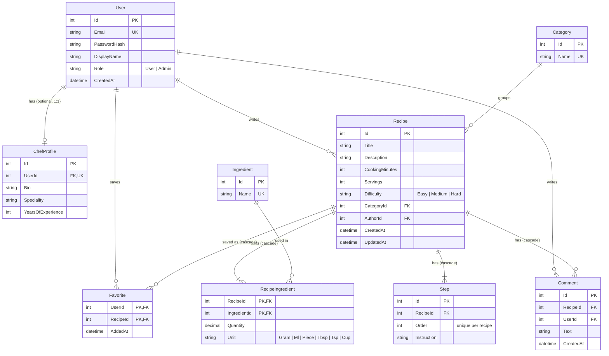

# RecipeBook — REST API on ASP.NET Core

A recipe platform API. Users publish recipes with ordered steps and ingredient lists, comment on recipes, and save other people's recipes to their favorites. Each user can also fill in an optional chef profile. Admins manage the lookup lists (categories, ingredients) and can delete any recipe or comment.

Course project #2 ("რეცეპტების პლატფორმა — RecipeBook") from *REST API პროექტები ASP.NET Core-ზე*, including the bonus task (*"What can I cook?"*).

## Tech stack

| Part | Choice |
|---|---|
| Framework | ASP.NET Core Web API, .NET 8, controller-based |
| Database | Entity Framework Core 8 + **SQLite** (schema created by migrations) |
| Auth | JWT Bearer (`Microsoft.AspNetCore.Authentication.JwtBearer`), roles `User` / `Admin` |
| Passwords | `BCrypt.Net-Next`, only the hash is stored |
| Validation | FluentValidation (`FluentValidation.DependencyInjectionExtensions`) |
| Mapping | AutoMapper 13 (the DI extension is built into this version) |
| Docs | Swagger / Swashbuckle with the **Authorize** button for Bearer tokens |
| Tests | xUnit + `WebApplicationFactory` integration tests + `AssertConfigurationIsValid` |

## How to run

Requirements: [.NET 8 SDK](https://dotnet.microsoft.com/download). No database server is needed, because SQLite is a single file.

```bash
git clone <this-repo-url>
cd RecipeBook

# 1. (optional) EF Core CLI, if you want to run migrations by hand
dotnet tool install --global dotnet-ef --version 8.*

# 2. Create the database from the migrations
dotnet ef database update --project src/RecipeBook.Api

# 3. Run the API
dotnet run --project src/RecipeBook.Api
```

Then open **http://localhost:5080/swagger**.

- Step 2 is optional. On startup the app calls `Database.Migrate()` itself and then seeds the demo users and recipes, so `dotnet run` on a fresh clone is enough.
- **Connection string**: `ConnectionStrings:DefaultConnection` in `src/RecipeBook.Api/appsettings.json` (default `Data Source=recipebook.db`).
- **JWT settings**: the `Jwt` section in `appsettings.json` (`Key` must be at least 32 characters, `ExpiresInHours` 1–24). The app refuses to start if these are invalid. The key in the repo is a development key. For a real deployment, override it with an environment variable (`Jwt__Key=...`) or `dotnet user-secrets`.
- To start from an empty database, stop the app and delete `src/RecipeBook.Api/recipebook.db`.

### Using Swagger
1. `POST /api/auth/login` with one of the seed accounts below and copy `accessToken`.
2. Press **Authorize** (top right) and paste the token (without the word `Bearer`).
3. Every request now sends `Authorization: Bearer <token>`.

There is also `src/RecipeBook.Api/RecipeBook.http`, a ready-made demo scenario you can run request by request in VS / Rider / VS Code: register, validation error, login, 401, 403, create, ownership, favorites, bonus.

### Running the tests
```bash
dotnet test
```
Each test class starts the real API in memory on its own temporary SQLite file (migrations + seed included).

## Seed data

| Role | Email | Password | Notes |
|---|---|---|---|
| Admin | `admin@recipebook.ge` | `Admin123!` | the only admin |
| User | `nino@recipebook.ge` | `Nino1234!` | has a chef profile, 2 recipes |
| User | `giorgi@recipebook.ge` | `Giorgi123!` | **no** chef profile (the 1:1 is optional), 2 recipes, 1 comment, 1 favorite |

- **Categories** (7) and **ingredients** (25) are seeded by the migration itself via `HasData()`, so they have fixed ids (e.g. category `3` = ცომეული, ingredient `1` = ფქვილი, `7` = კვერცხი, matching the example body in the assignment).
- **Users, recipes, a comment and a favorite** are seeded on startup by `Data/Seed/DbSeeder.cs`, only if the `Users` table is empty. They can't go into `HasData()` because BCrypt hashes are different on every run.

**Role assignment.** `POST /api/auth/register` always creates a `User`. The `RegisterRequest` in the assignment has no role field, and letting anyone register as Admin would defeat the role. The admin account comes from the seed.

## Data model



### Relationships and why they are configured this way
All relationships are configured with the Fluent API in `Data/Configurations/*Configuration.cs` (one `IEntityTypeConfiguration<T>` per entity, registered with `ApplyConfigurationsFromAssembly`).

| Type | Relationship | Configuration |
|---|---|---|
| **1:1** | User ↔ ChefProfile | FK `ChefProfile.UserId` + **unique index** on it. The profile is optional. Cascade: the profile is deleted with its user. |
| **1:N** | Recipe → Step | Cascade: steps are created and deleted with the recipe. Unique index `(RecipeId, Order)`. |
| **1:N** | Category → Recipe | **Restrict**: a category that still has recipes cannot be deleted. |
| **1:N** | User → Recipe, Recipe → Comment | Recipe → Comment is Cascade. User → Recipe and User → Comment are Restrict, so `Comment` has only one cascade path (SQL Server rejects "multiple cascade paths"). |
| **N:M + extra fields** | Recipe ↔ Ingredient via **RecipeIngredient** | Explicit join entity, because the link itself carries `Quantity` and `Unit`. EF's automatic join table can't hold extra columns. Composite PK `(RecipeId, IngredientId)`, so an ingredient appears once per recipe. Ingredient side is Restrict. |
| **N:M + date** | User ↔ Recipe via **Favorite** | Explicit join entity with `AddedAt`. Composite PK `(UserId, RecipeId)` makes a duplicate favorite impossible at database level. |

Enums (`Role`, `Difficulty`, `Unit`) are stored as text (`HasConversion<string>()`) so the database stays readable.

## Endpoints

| Method | Route | Access | Description |
|---|---|---|---|
| POST | `/api/auth/register` | public | Register (role `User`) → 201 |
| POST | `/api/auth/login` | public | `{ accessToken, expiresAt, ... }` |
| GET | `/api/me/chef-profile` | User | My profile (404 if none) |
| PUT | `/api/me/chef-profile` | User | Upsert: 201 when created, 200 when updated |
| GET | `/api/users/{id}/chef-profile` | Auth | Someone's profile + `recipesCount` |
| GET | `/api/categories` | Auth | Paginated list |
| POST | `/api/categories` | Admin | Add (409 if the name exists) |
| GET | `/api/ingredients` | Auth | Paginated, `?search=` |
| POST | `/api/ingredients` | Admin | Add (409 if the name exists) |
| GET | `/api/recipes` | Auth | `?categoryId=&difficulty=&maxMinutes=&ingredientId=&authorId=&search=&page=&pageSize=` |
| GET | `/api/recipes/{id}` | Auth | Full recipe: sorted steps, ingredients, author, comments, `isFavorite` |
| POST | `/api/recipes` | User | Create with steps and ingredients in one request → 201 |
| PUT | `/api/recipes/{id}` | author / Admin | Full update, steps and ingredients replaced |
| DELETE | `/api/recipes/{id}` | author / Admin | Delete (cascade) → 204 |
| POST | `/api/recipes/{id}/comments` | User | Comment → 201 |
| DELETE | `/api/recipes/{id}/comments/{commentId}` | comment author / recipe author / Admin | → 204 |
| POST | `/api/recipes/{id}/favorite` | User | Add to favorites → 201 (409 if already there) |
| DELETE | `/api/recipes/{id}/favorite` | User | Remove → 204 |
| GET | `/api/me/favorites` | User | My favorites (paginated) |
| GET | `/api/me/recipes` | User | My recipes (paginated) |
| POST | `/api/recipes/search-by-ingredients` | Auth | **Bonus**, see below |

"User" in the access column means the `User` role, exactly as in the assignment table: `[Authorize(Roles = "User")]`. An Admin calling those endpoints gets 403. "author / Admin" endpoints only require a valid token at controller level; the ownership check happens in the service.

All lists return `{ items, totalCount, page, pageSize, totalPages }`. Defaults are `page=1`, `pageSize=20`, maximum 100.

### Status codes and error format
`200` read/update · `201` create · `204` delete · `400` validation or business rule · `401` no or invalid token · `403` wrong role or not the owner · `404` not found · `409` already exists.

**Every** 4xx response (validation, business rules, 401/403 from the JWT handler, even unknown routes) uses one shape:
```json
{
  "status": 400,
  "message": "Validation failed",
  "errors": {
    "title": ["Title must be between 3 and 150 characters."],
    "steps": ["Step orders must be sequential starting from 1 (1, 2, 3, ...)."],
    "ingredients[0].unit": ["Unit must be one of: Gram, Ml, Piece, Tbsp, Tsp, Cup."]
  }
}
```

## Validation (FluentValidation)
Every request DTO has its own validator in `Validators/`. All broken rules come back in **one** response.

| Request | Rules |
|---|---|
| `RegisterRequest` | email valid + unique (`MustAsync`), password ≥ 8 with ≥ 1 digit, displayName 2–50 |
| `LoginRequest` | email valid, password required |
| `UpsertChefProfileRequest` | bio ≤ 1000, speciality 2–80, yearsOfExperience 0–70 |
| `CreateRecipeRequest` / `UpdateRecipeRequest` | title 3–150, description ≤ 2000, cookingMinutes 1–1440, servings 1–50, difficulty valid enum name, category exists; steps ≥ 1, `Order` unique and sequential 1, 2, 3…, instruction 3–500; ingredients ≥ 1, ids unique and existing in the DB, 0 < quantity ≤ 10000, unit valid enum name |
| `CreateCommentRequest` | text 1–500 (whitespace-only rejected) |
| `CreateCategoryRequest` / `CreateIngredientRequest` | name 2–50 |
| `SearchByIngredientsRequest` | 1–100 unique positive ids |
| Query objects | page ≥ 1, pageSize 1–100, maxMinutes > 0, search ≤ 100 |

How it's wired:
- The collections use `RuleForEach(...).SetValidator(new StepRequestValidator())` / `new IngredientLineValidator()`.
- Create and Update share one abstract `RecipeWriteRequestValidator<T>`, so the rules aren't copy-pasted.
- Database checks (category exists, ingredients exist, email unique) run inside the validators with `MustAsync` / `CustomAsync`. Name uniqueness for categories and ingredients is a 409 Conflict from the service, which matches the "409 — already exists" row of the REST conventions.
- Validators run in a small global action filter, `Filters/ValidationFilter.cs`, which calls `ValidateAsync`. The older `FluentValidation.AspNetCore` auto-validation runs validators *synchronously* and would throw on the `MustAsync` rules.
- `difficulty` and `unit` arrive as strings and are checked with `IsEnumName`. If they were enum-typed, a wrong value like `"Super"` would break JSON deserialization of the whole body, and the client would see only that one error instead of all of them.

## Mapping (AutoMapper)
One `Profile` per module in `Mapping/` (`AuthProfile`, `ChefProfileProfile`, `CategoryProfile`, `IngredientProfile`, `RecipeProfile`, `CommentProfile`, `FavoriteProfile`). Controllers only ever receive and return DTOs.

Custom mappings (`ForMember` + `MapFrom`):
- `RecipeListDto`: `CategoryName` ← `Category.Name`, `AuthorName` ← `Author.DisplayName`, `FavoritesCount` ← `Favorites.Count`, `CommentsCount` ← `Comments.Count`
- `RecipeDetailsDto`: `Steps` sorted by `Order`; `Ingredients` flattened (`IngredientName` ← `Ingredient.Name`); `AuthorSpeciality` ← `Author.ChefProfile.Speciality` or `null`; `IsFavorite` ignored in the map and set by `RecipeService` for the current user
- `CreateRecipeRequest → Recipe` with nested `Steps` and `RecipeIngredients` (`Ingredients` → `RecipeIngredients`, string → enum for `Difficulty` / `Unit`)
- `ChefProfileDto.RecipesCount` ← `User.Recipes.Count`, `FavoriteDto` flattened from `Favorite → Recipe → Category/Author`

DTOs are flat or nested one level deep, so there are no cycles. Read queries use `ProjectTo<T>()`, so the counts become SQL `COUNT`s and only the needed columns are loaded. The `AutoMapper_configuration_is_valid` test calls `AssertConfigurationIsValid()`.

## Business rules (all in the service layer)
1. **Ownership**: only the recipe's author or an Admin may edit or delete it, otherwise 403 (`RecipeService.EnsureCanModify`).
2. **Update replaces children in one transaction**: `RecipeService.UpdateAsync` opens a transaction, deletes the old `Steps` and `RecipeIngredients` (`ExecuteDeleteAsync`), maps the new ones in, saves, and commits.
3. **Delete cascades**: steps, ingredient links, comments and favorites are removed by `ON DELETE CASCADE`.
4. **Comment deletion**: allowed for the comment's author, the recipe's author or an Admin (`CommentService.DeleteAsync`).
5. **`UpdatedAt`** is set on every update (it is `null` until the first update).
6. Extra: a user can't favorite their **own** recipe (400). The assignment describes favorites as saving *other people's* recipes.

Services throw `NotFoundException`, `BusinessRuleException`, `ForbiddenException`, `ConflictException` or `UnauthorizedException`. One `IExceptionHandler` (`Infrastructure/GlobalExceptionHandler.cs`) turns them into the matching status code, so controllers have no `try/catch` and no business logic.

## Bonus — "What can I cook?"
`POST /api/recipes/search-by-ingredients` with `{ "ingredientIds": [12, 13, 10, 14] }` returns:
```json
{
  "canCook":       [ /* recipes whose every ingredient is in the list */ ],
  "almostCanCook": [ /* recipes missing at most 2 ingredients, sorted by how many are missing */
    { "id": 4, "title": "პომიდვრისა და კიტრის სალათი ნიგვზით", "totalIngredients": 6,
      "missingIngredients": ["მარილი", "ნიორი"], "...": "..." }
  ]
}
```
The filtering ("uses at least one of my ingredients and lacks at most 2") runs in SQL. A second query then fetches the names of the missing ingredients.

## Project structure
```
RecipeBook/
├── src/RecipeBook.Api/
│   ├── Controllers/       Auth, ChefProfiles, Categories, Ingredients, Recipes, Comments, Favorites
│   ├── Services/          business logic + Interfaces/ (all registered in DI)
│   ├── Data/              AppDbContext, Configurations/ (Fluent API), Seed/, Migrations/
│   ├── Entities/          User, ChefProfile, Category, Ingredient, Recipe, Step, RecipeIngredient, Comment, Favorite
│   ├── DTOs/              request/response models per module + Common/ (PagedResult, ErrorResponse, PaginationQuery)
│   ├── Validators/        one FluentValidation validator per request
│   ├── Mapping/           one AutoMapper profile per module
│   ├── Exceptions/        NotFound / BusinessRule / Forbidden / Conflict / Unauthorized
│   ├── Filters/           ValidationFilter (async FluentValidation)
│   ├── Infrastructure/    GlobalExceptionHandler, error-key helper
│   ├── Extensions/        DI setup, JWT + Swagger setup, paging helper, migrate & seed
│   ├── Options/           JwtSettings (validated on startup)
│   ├── appsettings.json
│   ├── RecipeBook.http    demo scenario
│   └── Program.cs
└── tests/RecipeBook.Tests/  AutoMapper config test + API integration tests
```

## Notes
- `dotnet build` finishes with **0 warnings and 0 errors**.
- **AutoMapper version.** The project uses AutoMapper **13.0.1**, the last MIT-licensed release. From version 15 AutoMapper requires a commercial or community license key. NuGet's audit flags 13.x (and 14.x) with advisories (NU1903) about deeply nested or recursive object graphs. This API only maps flat, one-level DTOs built by the server itself, so those scenarios don't apply. The warning is therefore suppressed **for the AutoMapper package only** (`NoWarn="NU1903"` on that one `PackageReference`), so audit warnings for any other package still show up.
- All timestamps are stored in UTC (`DateTime.UtcNow`).
- SQLite stores `decimal` as text. That's fine here because quantities are only stored and displayed, never sorted or summed in SQL. Switching to SQL Server or PostgreSQL only means changing the provider package, `UseSqlite(...)` and the connection string, then regenerating the migration.
